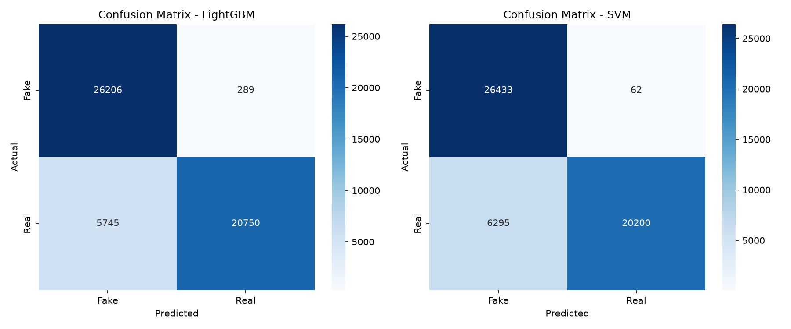

# Mereproduksi Jurnal Forensik Digital: Deteksi Foto & Video Palsu dengan DFT + SVM

Setiap hari jutaan foto dan video beredar di media sosial, dan sebagian di antaranya adalah hasil manipulasi: foto uji rudal yang diedit, wajah yang ditukar, berita palsu yang memakai gambar "bukti". Mata manusia sudah tidak lagi bisa diandalkan untuk membedakannya — mata yang awas pun bisa tertipu oleh manipulasi yang rapi.

Di dunia penyelidikan digital, kebutuhan akan alat yang bisa memilah otomatis antara file asli dan file palsu menjadi sangat nyata. Postingan ini membahas bagaimana saya **merekonstruksi kode dari sebuah jurnal ilmiah** — Ferreira, Antunes, & Correia (2021), *Exposing Manipulated Photos and Videos in Digital Forensics Analysis*, Journal of Imaging 7(7), 102 — yang menawarkan resep sederhana namun memukau: **DFT + SVM**.

Alur pembahasan disusun berjenjang, dari pengenalan umum menuju detail teknis dan hasil eksperimen.

---

## Tingkat 1 — Masalah: tiga jenis manipulasi yang harus diwaspadai

Sebelum bicara algoritma, penting untuk tahu apa yang sebenarnya mau kita deteksi. Jurnal ini mengelompokkan manipulasi citra menjadi tiga jenis utama:

1. **Copy–move** — bagian foto disalin atau dipindahkan ke lokasi lain *di dalam foto yang sama*, sehingga tercipta ilusi seolah ada lebih banyak objek daripada kenyataannya. Contoh klasik: foto peluncuran rudal Iran yang seolah menampilkan empat rudal, padahal hanya tiga yang benar-benar diluncurkan. Teknik ini populer karena mudah, dan area bertekstur (rumput, kerikil, kain) membuat salinan sulit dikenali mata.
2. **Splicing** — region dari dua foto berbeda digabungkan. Transisi tepi dan sudut yang diperkenalkan secara manual berbeda dari foto asli, dan perbedaan itulah yang menjadi jejak forensik.
3. **Deepfake** — manipulasi otomatis berbasis AI (biasanya GAN atau auto-encoder) yang menukar wajah seseorang dengan orang lain dalam foto atau video. Istilahnya sendiri adalah gabungan *"deep learning"* dan *"fake"*.

Ketiganya pada akhirnya meninggalkan **jejak halus pada statistik frekuensi gambar** — dan di situlah ide inti jurnal ini bekerja.

## Tingkat 2 — Ide inti: melihat citra di domain frekuensi

Alih-alih menganalisis piksel secara langsung, jurnal mengubah perspektif citra ke **domain frekuensi** menggunakan Discrete Fourier Transform (DFT). Secara konsep:

> DFT memecah sinyal diskret menjadi komponen sinusoidal berbagai frekuensi — dari frekuensi 0 (rata-rata citra) hingga frekuensi maksimum yang diizinkan resolusi spasial.

Citra yang dimanipulasi (terutama hasil splicing/copy-move) memiliki pola energi frekuensi yang sedikit berbeda dari citra asli, karena proses penyuntingan meninggalkan sinyal buatan yang tidak konsisten.

### 2.1. Dari spektrum 2D menjadi 50 angka

Pipeline ekstraksi fitur (persis seperti jurnal, diimplementasikan di `scripts/feature_extraction.py`) berjalan sebagai berikut:

1. **Baca citra grayscale** dengan OpenCV (`cv2.imread(img, 0)`).
2. **DFT 2D**: `np.fft.fft2(img)` lalu `np.fft.fftshift(f)` — komponen DC (frekuensi 0) dipindahkan ke tengah agar spektrum simetris radial.
3. **Koreksi numerik**: tambahkan `epsilon = 1e-8` agar `log(0)` tidak meledak.
4. **Magnitude spectrum dalam desibel**: `20 * log10(|F|)`.
5. **Azimuthal average** (rata-rata azimutal): spektrum 2D diratakan menjadi kurva 1D terhadap jarak dari pusat — inilah "sidik jari" frekuensi citra.
6. **Interpolasi cubic** ke **50 titik seragam** → menghasilkan 50 fitur.
7. **Normalisasi terhadap komponen pertama (DC)**, sehingga fitur tidak bergantung pada kecerahan global citra.

Hasil akhirnya: setiap citra hanya direpresentasikan oleh **vektor 50 angka**. Ringan, cepat, dan cukup informatif.

### 2.2. Mengapa 50 fitur?

Jurnal menyebut jumlah fitur adalah pilihan yang mempertimbangkan waktu komputasi vs skor klasifikasi. Lima puluh angka per citra membuat model klasik (bukan deep learning) tetap kompetitif dengan jauh lebih sedikit data dan waktu proses — sebuah trade-off yang disengaja dan akan terlihat hasilnya di bagian akhir.

## Tingkat 3 — Klasifikasi: Support Vector Machine (SVM)

Setelah fitur siap, tugas klasifikasi dijatuhkan ke **SVM** — algoritma klasifikasi supervised berbasis Statistical Learning Theory (Vapnik) yang mencari **hyperplane pemisah dengan margin maksimal** antara kelas *fake* dan *real*.

Karena data tidak selalu linearly separable di ruang fitur asli, SVM memakai **kernel trick**: data dipetakan ke ruang dimensi lebih tinggi lewat fungsi kernel, tanpa perlu menghitung pemetaannya secara eksplisit.

Konfigurasi yang dipakai — **disalin persis dari penulis jurnal** agar perbandingan adil:

```python
SVC(
    C=6.37,           # regularisasi (parameter persis penulis)
    kernel='rbf',     # Radial Basis Function
    gamma=0.86,       # lebar kernel RBF
    probability=True,
)
```

## Tingkat 4 — Rekayasa kode: pipeline eksperimen

Jurnal menjalankan evaluasi dengan **5-fold cross-validation**. Implementasi ada di `scripts/train_benchmark.py` dengan alur:

1. **Load dataset** — file `.pkl` penulis berisi dictionary `data["data"]` (matriks fitur 50 DFT) dan `data["label"]` (0 = fake, 1 = real).
2. **Stratified K-Fold (k=5)** — proporsi kelas tetap seimbang di tiap fold, dengan `shuffle=True` dan `random_state=42` agar hasil dapat direproduksi.
3. **Latih SVM** dengan parameter persis penulis.
4. **Hitung metrik** per fold: accuracy, precision, recall, F1, dan confusion matrix; waktu pelatihan diukur terpisah.
5. **Simpan model final** yang dilatih ulang pada seluruh data ke `models/svm_model.pkl`.

Dataset yang dipakai (`datasets/train_all.pkl`) berisi **52.990 sampel** — persis sama dengan total dataset jurnal — dengan komposisi seimbang:

| Komponen | Jumlah |
|---|---|
| Total sampel | 52.990 |
| Kelas 0 (Fake/Manipulated) | 26.495 |
| Kelas 1 (Real/Authentic) | 26.495 |

Angka ini konsisten dengan dataset jurnal (foto asli + frame video hasil ekstraksi 3 frame/detik dari Celeb-DFv1, ditambah sumber COVERAGE, Columbia Splicing, dll.).

## Tingkat 5 — Hasil: reproduksi vs jurnal

**Peringatan konvensi:** jurnal mendefinisikan *positive class* = **foto manipulasi (fake)**, sementara keluaran standar scikit-learn di kode kita memakai *positive class* = kelas 1 (real). Agar perbandingan apple-to-apple, tabel di bawah memakai **metrik untuk kelas 0 (fake)** dari classification report, yaitu definisi yang sama dengan jurnal.

| Metrik (dataset foto + video, 5-Fold CV) | Jurnal (Tabel 6) | Reproduksi (SVM) |
|---|---|---|
| Precision (kelas fake) | 81,14% | **80,77%** |
| Recall (kelas fake) | 98,79% | **99,77%** |
| F1-Score (kelas fake) | 89,10% | **89,27%** |
| Accuracy | 87,92% | **88,00%** |

Seluruh selisih berada **di bawah 1 poin persen** (akurasi bahkan hanya 0,08 poin persen) — reproduksi kode jurnal dari nol terbukti berhasil memperoleh perilaku yang setara dengan yang dilaporkan penulis.

Confusion matrix akumulasi seluruh fold:

```
SVM (52.990 prediksi)
             Pred Fake  Pred Real
Actual Fake      26433         62
Actual Real       6295      20200
```

Artinya hampir semua foto palsu tertangkap (hanya 62 yang lolos sebagai "real"), sementara 6.295 foto asli masih diklasifikasikan keliru sebagai palsu — karakteristik konservatif yang *dapat dimaklumi* dalam konteks forensik: **lebih baik menandai mencurigakan lalu diverifikasi manual, daripada lolos diam-diam**.



*(Plot di atas dihasilkan oleh `train_benchmark.py`; kolom kanan akan dibahas mendalam di postingan UTS.)*

### 5.1. Perbandingan waktu proses dengan deep learning

Jurnal juga membandingkan DFT-SVM dengan CNN dan menemukan hal menarik untuk praktisi:

| Waktu testing (hh:mm:ss) | Foto | Video |
|---|---|---|
| DFT + SVM | 00:00:51 | 00:02:00 |
| CNN | 06:36:00 | 02:40:00 |

CNN memang sedikit lebih akurat, tetapi biaya komputasinya jauh lebih besar — sehingga DFT-SVM justru lebih layak disematkan sebagai modul alat forensik sehari-hari (jurnal mengintegrasikannya ke aplikasi open-source **Autopsy**).

## Tingkat 6 — Uji nyata pada satu citra

Teori baru terasa lengkap ketika diuji pada file sungguhan. Dengan `scripts/predict_image_svm.py`, satu citra mentah dibaca → 50 fitur DFT diekstrak (pipeline identik dengan saat training) → diprediksi:

```bash
python scripts/predict_image_svm.py data/real.jpeg
python scripts/predict_image_svm.py data/fake.jpeg
```

```
HASIL ANALISIS FORENSIK (SVM)
  File citra        : real.jpeg
  Jumlah fitur DFT  : 50
  Prob. FAKE (0)    : 0.37 %
  Prob. REAL (1)    : 99.63 %
  Kesimpulan        : REAL (Authentic)

HASIL ANALISIS FORENSIK (SVM)
  File citra        : fake.jpeg
  Jumlah fitur DFT  : 50
  Prob. FAKE (0)    : 92.46 %
  Prob. REAL (1)    : 7.54 %
  Kesimpulan        : FAKE (Manipulated)
```

Kedua citra terklasifikasi dengan benar, dengan tingkat keyakinan yang tinggi.

## Catatan jujur & batasan

- **Konvensi positive class berbeda** antara jurnal (fake) dan keluaran default scikit-learn (real) — sudah disesuaikan saat membandingkan.
- **Satu kali run, dataset `.pkl` penulis**: hasil bisa sedikit berbeda jika dataset, versi library, atau seed berubah.
- **Recall kelas real masih 76,24%** — banyak foto asli yang ditandai palsu. Di konteks forensik ini *false alarm*, bukan kebocoran bukti, tetapi tetap membebani pemeriksaan manual.
- Dataset jurnal mencampur foto statis dan frame video; tingkat kesulitan keduanya berbeda (jurnal sendiri melaporkan F1 99,53% untuk foto murni vs 79,55% untuk video murni).

## Kesimpulan

1. **Domain frekuensi + model klasik masih relevan.** Hanya dengan 50 fitur hasil rata-rata azimutal DFT, SVM mampu mencapai akurasi 88% dan F1 89,27% pada 52.990 sampel — setara pelaporan jurnal.
2. **Reproduksi ilmiah itu mungkin.** Parameter persis penulis (`C=6.37`, RBF, `gamma=0.86`) + protokol 5-fold stratified menghasilkan selisih < 2 poin persen dari angka jurnal.
3. **Trade-off adalah kunci.** DFT-SVM kalah tipis dari CNN dalam akurasi, tetapi menang telak dalam waktu proses — cocok untuk alat forensik yang harus memproses ribuan file.

Langkah lanjutan — menambahkan classifier gradient boosting agar lebih cepat dan akurat — dibahas di postingan UTS.

## Referensi

1. Ferreira, S.; Antunes, M.; Correia, M.E. *Exposing Manipulated Photos and Videos in Digital Forensics Analysis*. **J. Imaging 2021, 7, 102**. https://doi.org/10.3390/jimaging7070102
2. Durall, R.; Keuper, M.; Pfreundt, F.J.; Keuper, J. *Unmasking deepfakes with simple features*. arXiv:1911.00686. (dasar metode DFT-SVM)
3. Dataset & kode penulis: https://github.com/saraferreirascf/Photo-and-video-manipulations-detector
4. Kode reproduksi ini: `scripts/feature_extraction.py`, `scripts/train_benchmark.py`, `scripts/predict_image_svm.py`
