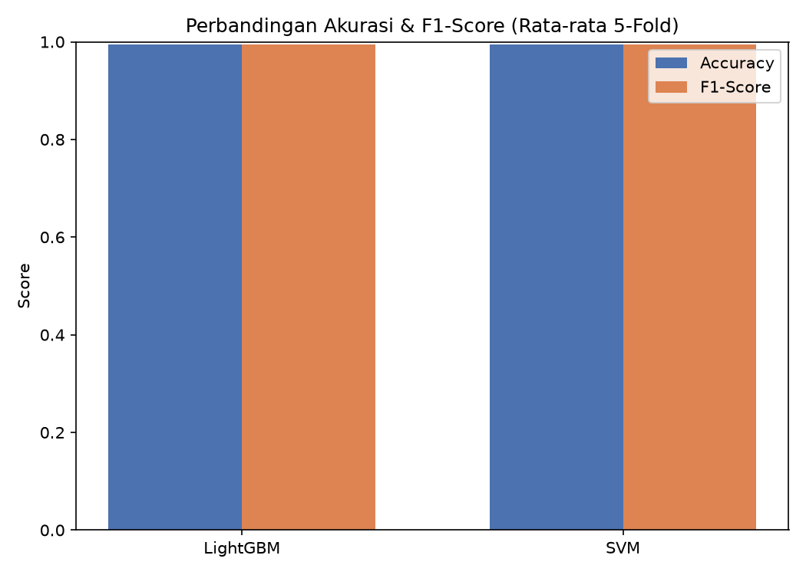

# Dari SVM ke LightGBM: Mengoptimalkan Deteksi Manipulasi Citra dengan Gradient Boosting

[Postingan tugas sebelumnya](https://medium.com/@hidayathikmat8/mereproduksi-jurnal-forensik-digital-deteksi-foto-video-palsu-dengan-dft-svm-699d765e3406) membuktikan bahwa resep [jurnal Ferreira et al. (2021)](https://doi.org/10.3390/jimaging7070102) — **50 fitur DFT + SVM** — bisa direproduksi dari nol: akurasi **88,00%**, F1 **89,27%** pada 52.990 sampel, selisih tipis dari pelaporan jurnal (87,92% / 89,10%). Kode eksperimen yang sama, kini dengan dua model berjalan berdampingan, ada di [repo projetcmodel](https://github.com/hikproject/projetcmodel).

Namun satu angka mengganjal: **SVM butuh rata-rata 250,58 detik untuk melatih satu fold**. Kalau dataset tumbuh, atau alat forensik harus dilatih ulang berkali-kali, waktu itu menumpuk. Pertanyaan postingan ini:

> **Bisakah classifier lain — Gradient Boosting (LightGBM) — memberi akurasi lebih baik dengan waktu training yang jauh lebih ringan, tanpa mengubah fitur DFT sama sekali?**

Jawabannya ada di hasil eksperimen, setelah kita menapak tiga tingkat pemahaman berikut.

---

## Tingkat 1 — Masalah: ke mana batas SVM?

SVM bekerja dengan mencari hyperplane pemisah dengan margin maksimal. Ia andal, sederhana, dan sudah teruji puluhan tahun — tetapi pun dua keterbatasan praktis:

1. **Biaya training naik tajam seiring data.** Untuk kernel non-linear seperti RBF, SVM harus mempertimbangkan interaksi antar sampel; pada dataset 52.990 sampel × 50 fitur, training per fold memakan ~250 detik di mesin ini.
2. **Satu model, satu keputusan.** SVM pada dasarnya membangun *satu* pemisah optimal. Ia tidak "belajar bertahap dari kesalahan".

Gradient boosting dirancang justru untuk celah kedua itu.

## Tingkat 2 — Dasar teori: Gradient Boosting & LightGBM (versi praktisi)

Bayangkan deretan model sederhana (pohon keputusan) yang dilatih **berurutan**:

- Pohon pertama menebak label dengan kemampuan pas-pasan.
- Pohon berikutnya **tidak menebak label dari awal**, melainkan fokus memperbaiki **sisa kesalahan (residual)** pohon sebelumnya.
- Setiap pohon hanya menambah sedikit perbaikan — inilah makna *"boosting"* dengan *learning rate* kecil.
- Gabungan ratusan pohon kecil itu akhirnya menjadi model yang jauh lebih kuat daripada satu model besar.

**LightGBM** adalah implementasi gradient boosting yang dirancang untuk kecepatan dan efisiensi memori. Dua keunggulan utamanya:

- **Leaf-wise growth** — pohon tumbuh ke daun yang paling menurunkan error (dikontrol `num_leaves`), bukan penuh per level.
- **Gradient-based One-Side Sampling (GOSS)** — sampel dengan gradien besar (yang "paling sulit") diprioritaskan, sehingga informasi belajar lebih terkonsentrasi.

Keduanya membuat training lebih cepat tanpa harus memperbesar data.

## Tingkat 3 — Konfigurasi yang dipakai di kode

Implementasi ada di [`scripts/train_benchmark.py` baris 222](https://github.com/hikproject/projetcmodel/blob/main/scripts/train_benchmark.py#L222). Parameter dibuat **konservatif** agar model tidak overfit dan tetap stabil pada data di luar dataset:

```python
lgb.LGBMClassifier(
    n_estimators=300,        # jumlah pohon; cukup tinggi agar lr=0.03 konvergen
    learning_rate=0.03,      # langkah perbaikan kecil tiap pohon
    num_leaves=31,           # kompleksitas sedang (default ideal)
    max_depth=-1,            # biarkan num_leaves yang mengatur kedalaman
    min_data_in_leaf=20,     # ambang sampel per daun
    feature_fraction=0.8,    # tiap pohon pakai 80% fitur secara acak
    subsample=0.8,           # 80% sampel per pohon (bagging)
    subsample_freq=1,        # wajib diisi agar bagging aktif
    reg_alpha=0.1,           # regularisasi L1
    reg_lambda=1.0,          # regularisasi L2
    n_jobs=-1,               # pakai semua core CPU
    random_state=42,
)
```

Tiga keputusan desain yang patut dicatat untuk praktisi:

- **`learning_rate` kecil + `n_estimators` besar** — kombinasi standar: belajar pelan tapi cukup lama, umumnya lebih baik daripada belajar cepat dengan sedikit pohon.
- **`feature_fraction=0.8`** — setiap pohon hanya melihat 80% fitur, memaksa keragaman antar pohon (mirip inti random forest).
- **Regularisasi (`reg_alpha`, `reg_lambda`)** — menahan model agar tidak hafal data training.

## Tingkat 4 — Protokol eksperimen: perbandingan yang adil

Agar hasil benar-benar bisa dibandingkan, **semua hal kecuali nama model dijaga identik** dengan [eksperimen tugas](https://medium.com/@hidayathikmat8/mereproduksi-jurnal-forensik-digital-deteksi-foto-video-palsu-dengan-dft-svm-699d765e3406):

| Komponen | Pengaturan |
|---|---|
| Fitur | 50 fitur DFT (azimuthal average), pipeline `feature_extraction.py` identik |
| Dataset | [`datasets/train_all.pkl`](https://github.com/saraferreirascf/Photos-Videos-Manipulations-Dataset) — 52.990 sampel (26.495 fake / 26.495 real) |
| Validasi | 5-Fold **Stratified** Cross-Validation, `shuffle=True`, `random_state=42` |
| Baseline | SVM persis penulis: `C=6.37`, `kernel='rbf'`, `gamma=0.86` |
| Kandidat | LightGBM dengan konfigurasi Tingkat 3 |
| Metrik | Accuracy, Precision, Recall, F1, confusion matrix, waktu training/fold |

Satu script menjalankan keduanya bergantian di fold yang sama — jadi perbedaan hasil murni berasal dari model, bukan dari pembagian data.

## Tingkat 5 — Hasil eksperimen

### 5.1. Metrik utama (rata-rata 5 fold)

| Metrik (kelas fake, definisi sama dengan jurnal) | Jurnal (SVM) | Reproduksi SVM | **LightGBM** |
|---|---|---|---|
| Precision | 81,14% | 80,77% | **82,02%** |
| Recall | 98,79% | 99,77% | **98,91%** |
| F1-Score | 89,10% | 89,27% | **89,68%** |
| Accuracy (mean ± std) | 87,92% | 88,00% ± 0,28% | **88,61% ± 0,30%** |

> Catatan: keluaran bawaan `results.txt` memakai *positive class* = kelas 1 (real), sehingga angka precision/recall di sini diambil dari kolom **kelas 0 (fake)** pada classification report — sama seperti konvensi jurnal.

**LightGBM unggul di semua metrik klasifikasi** — tipis tetapi konsisten, dan akurasinya bahkan melampaui pelaporan jurnal asli.

### 5.2. Confusion matrix (akumulasi seluruh fold)

```
LightGBM (52.990 prediksi)        SVM (52.990 prediksi)
             Pred Fake  Pred Real              Pred Fake  Pred Real
Actual Fake      26206       289    Actual Fake      26433        62
Actual Real       5745     20750    Actual Real       6295     20200
```

Pola keduanya berlawanan arah:

- **SVM** hampir tidak pernah melepas fake (hanya 62 lolos), tapi menuduh 6.295 foto asli sebagai palsu.
- **LightGBM** jauh lebih seimbang: salah tuduh foto asli turun ke 5.745 (−550 kasus), dengan konsekuensi 289 fake lolos (vs 62 pada SVM).

Dalam bahasa praktisi: **LightGBM mengurangi *false alarm* separuh ribu kasus dengan "biaya" tambahan 227 fake yang lolos** — dan bahkan 289 lolos itu masih jauh di bawah ambang keputusan yang wajar (jurnal Autopsy sendiri menganggap video sebagai deepfake bila ≥ 1/3 frame-nya berstatus fake).

### 5.3. Kecepatan training — perbedaan paling dramatis

| Waktu training rata-rata per fold | LightGBM | SVM |
|---|---|---|
| 5 fold (rata-rata) | **0,41 detik** | 250,58 detik |
| Perbandingan | **≈ 610× lebih cepat** | 1× |



Sekali lagi, jurnal sendiri menegaskan bahwa *processing time* adalah alasan utama DFT-SVM mengalahkan CNN yang lebih akurat. LightGBM kini mengambil posisi itu: **akurasi lebih tinggi dari SVM, dengan biaya training yang bahkan jauh lebih ringan dari SVM**.

### 5.4. Classification report lengkap (LightGBM)

```
              precision    recall  f1-score   support
   0 (Fake)     0.8202    0.9891    0.8968     26495
   1 (Real)     0.9863    0.7832    0.8731     26495
   accuracy                         0.8861     52990
   macro avg    0.9032    0.8861    0.8849     52990
```

Kelas *real* memperoleh precision 98,63% — artinya ketika model menyatakan sebuah citra **asli**, ia benar hampir 99 dari 100 kali. Untuk alur forensik yang menandai file mencurigakan agar diperiksa manusia, ini profil kesalahan yang sehat.

## Tingkat 6 — Uji nyata pada satu citra

Sama seperti [postingan tugas](https://medium.com/@hidayathikmat8/mereproduksi-jurnal-forensik-digital-deteksi-foto-video-palsu-dengan-dft-svm-699d765e3406), kita uji dengan [`scripts/predict_image.py`](https://github.com/hikproject/projetcmodel/blob/main/scripts/predict_image.py) (model `models/lightgbm_model.txt`):

```bash
python scripts/predict_image.py data/real.jpeg
python scripts/predict_image.py data/fake.jpeg
```

```
File citra : real.jpeg   Prob. FAKE: 2.72%   Prob. REAL: 97.28%   → REAL (Authentic)
File citra : fake.jpeg   Prob. FAKE: 52.74%   Prob. REAL: 47.26%   → FAKE (Manipulated)
```

Kedua prediksi **benar**, tetapi perhatikan `fake.jpeg`: keyakinannya tipis (52,74%), sedangkan SVM memberi 92,46% pada citra yang sama. Ini contoh nyata bahwa **akurasi agregat yang lebih tinggi tidak menjamin keyakinan lebih tinggi pada tiap kasus individual** — LightGBM pada kasus ini lebih "ragu", dan kejujuran model untuk mengakui keraguan justru berguna: kasus seperti ini layak didorong ke pemeriksaan manual, bukan diambil keputusan otomatis.

## Kesimpulan berjenjang

1. **Dasar:** fitur DFT 50 dimensi tetap dipakai tanpa perubahan — *yang diubah hanya mesin klasifikasinya*.
2. **Menengah:** LightGBM (gradient boosting, `learning_rate=0.03`, 300 pohon) belajar dari kesalahan berurutan dan menahan overfit lewat regularisasi + sampling acak.
3. **Lanjut:** hasil — accuracy **88,61%** vs 88,00% (SVM), F1 **89,68%** vs 89,27%, dan training **0,41 s** vs 250,58 s per fold.
4. **Praktis:** trade-off kesalahan berubah dari "banyak false alarm" menjadi lebih seimbang, sementara waktu training turun ~610×.
5. **Wawasan:** metrik kuantitatif yang lebih baik ≠ keyakinan per kasus yang lebih baik — visualisasi probabilitas tetap perlu ditampilkan ke pengguna.

### Ide lanjutan

- **Tuning hyperparameter** (grid/random search, khususnya `num_leaves`, `min_data_in_leaf`, `learning_rate` × `n_estimators`) untuk mengangkat recall kelas *real* yang masih 78,32%.
- **Eksperimen per-dataset** (foto-only vs video-only) untuk meniru Tabel 4–6 jurnal.
- **Ensemble SVM + LightGBM** — jurnal secara eksplisit menyebut *ensemble* berbasis deep learning + SVM sebagai arah riset masa depan.
- **Kalibrasi probabilitas** agar output persentase (seperti 52,74% pada `fake.jpeg`) lebih terpercaya.

## Referensi

1. Ferreira, S.; Antunes, M.; Correia, M.E. *Exposing Manipulated Photos and Videos in Digital Forensics Analysis*. **J. Imaging 2021, 7, 102** — [https://doi.org/10.3390/jimaging7070102](https://doi.org/10.3390/jimaging7070102)
2. Ke, G. et al. *LightGBM: A Highly Efficient Gradient Boosting Decision Tree*. **NeurIPS 2017**.
3. [Kode asli & baseline penulis](https://github.com/saraferreirascf/Photo-and-video-manipulations-detector), [dataset `.pkl`](https://github.com/saraferreirascf/Photos-Videos-Manipulations-Dataset)
4. [Repositori eksperimen ini](https://github.com/hikproject/projetcmodel) — `scripts/train_benchmark.py` (training & benchmark), `scripts/predict_image.py` (prediksi LightGBM), laporan lengkap di `output/results.txt`
5. Postingan terkait: [*Mereproduksi Jurnal Forensik Digital: Deteksi Foto & Video Palsu dengan DFT + SVM*](https://medium.com/@hidayathikmat8/mereproduksi-jurnal-forensik-digital-deteksi-foto-video-palsu-dengan-dft-svm-699d765e3406)
